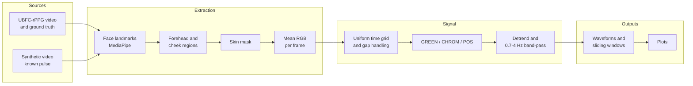

# Contactless Vitals

A Python package that extracts a pulse waveform from ordinary face video, using remote photoplethysmography (rPPG). It tracks the face, measures the colour of three skin regions frame by frame, and separates the tiny pulse signal from motion and lighting changes with three classic algorithms: GREEN, CHROM and POS.

This is the signal core. It stops at the waveform and does not estimate heart rate yet.

**Status:** tested on synthetic video and on real MediaPipe tracking of a portrait with a known pulse added. It has not yet been run on the UBFC-rPPG recordings, so there are no real-person results below.


## Problem

Each heartbeat changes skin colour very slightly, by well under 1% of its brightness. A camera can see this, which makes it possible to monitor a pulse without touching anyone.

The difficulty is that almost everything else changes the picture more than the pulse does. Head movement, flickering lights and shine on the skin are all far stronger. Some of them also repeat at heart-rate speeds, so a frequency filter alone can't remove them.

## Approach

1. **Track the face.** MediaPipe FaceLandmarker follows 478 landmarks through the video.
2. **Pick skin.** Landmarks define the forehead and both cheeks. A skin mask then removes hair, highlights and shadow, using each region's own median colour, so no skin tone is assumed.
3. **Average.** Each region becomes one mean RGB value per frame. Averaging hundreds of pixels is what lifts the pulse above sensor noise.
4. **Clean up timing.** The trace is resampled to even time steps. Short gaps are filled and long ones stay empty, so nothing is invented.
5. **Separate the pulse.** GREEN, CHROM and POS each turn the RGB trace into a pulse signal.
6. **Filter.** Smoothness-priors detrending, then a zero-phase 0.7 to 4 Hz band-pass.
7. **Output.** Waveforms for each method and each region, 10-second sliding windows, and plots.

| Algorithm | Idea | Protection against motion and lighting |
|---|---|---|
| **GREEN** (Verkruysse 2008) | Use the green channel, where the pulse is strongest | None |
| **CHROM** (de Haan 2013) | Combine colour differences so distortions cancel | Good, assumes a standard skin colour |
| **POS** (Wang 2017) | Project out the direction brightness changes move in | Good, learns from the data in each window |

[LEARNING.md](LEARNING.md) explains the physics and each algorithm in plain language.

## Architecture



| Module | Purpose |
|---|---|
| `contactless_vitals/data/ubfc.py` | Find subjects, validate files, read video and ground truth |
| `contactless_vitals/data/synthetic.py` | Synthetic videos with a known pulse |
| `contactless_vitals/face/` | Landmarks, region definitions, skin mask |
| `contactless_vitals/extract.py` | Frames to per-region mean RGB |
| `contactless_vitals/signal/` | Preprocessing, the three algorithms, windowing |
| `contactless_vitals/pipeline.py` | RGB trace to waveforms |
| `contactless_vitals/quality.py` | Scores against a known answer |
| `contactless_vitals/plots.py`, `cli.py` | Figures and the command line |

## Results

All numbers come from running `python evaluate.py`. Each scores the waveform against a frequency that is already known, so none of them is a heart-rate estimate. Full tables are in [results/synthetic_results.md](results/synthetic_results.md).

SNR compares the power at the pulse frequency and its second harmonic with everything else in the band. At 0 dB the two are equal, and at 10 dB the pulse has ten times the power. Values are the mean over 5 noise seeds, with the worst seed in brackets.


| Condition (pulse at 1.2 Hz) | GREEN | CHROM | POS |
|---|---|---|---|
| Clean | **26.1** (25.2) | 18.6 (17.5) | 18.6 (16.9) |
| Slow lighting drift | **21.3** (21.0) | 18.2 (17.1) | 18.3 (16.4) |
| Brightness flicker inside the band | -15.9 (-16.0) | 18.4 (17.1) | **18.5** (16.8) |
| Specular shine inside the band | -16.8 (-16.9) | 15.6 (15.1) | **18.9** (17.7) |
| Head sway with tracking noise | **24.8** (23.7) | 18.4 (17.4) | 18.3 (16.9) |
| No pulse at all (should be below 0) | -6.0 (-8.1) | -5.0 (-8.1) | -5.2 (-8.6) |

Real MediaPipe tracking of a swaying portrait with a known 1.3 Hz pulse added (single run):

| Portrait through MediaPipe | GREEN | CHROM | POS |
|---|---|---|---|
| SNR (dB) | 11.0 | 16.8 | **17.7** |

What these show:

- **Distortion inside the band is the real test.** A band-pass filter can't help there. GREEN falls by about 42 dB, while CHROM and POS stay near their clean scores.
- **Robustness has a cost.** With nothing disturbing the signal, GREEN is 7.5 dB ahead, because CHROM and POS add noise from the weaker channels.
- **Real tracking favours CHROM and POS.** In the portrait run GREEN drops to 11.0 dB. The synthetic head-sway test doesn't show this drop because its tracking is close to perfect.
- **No false pulse.** With no pulse in the video, every method stays below 0 dB.
- **Pulse rates across the band work.** From 0.8 to 3.5 Hz every method stays above 14 dB, even at its worst seed.

### Skin tone

| Synthetic skin tone | GREEN | CHROM | POS |
|---|---|---|---|
| Light, full pulse | 28.7 (28.0) | 21.9 (20.9) | 21.6 (19.9) |
| Medium, full pulse | 26.1 (25.2) | 18.6 (17.5) | 18.6 (16.9) |
| Dark, full pulse | 20.7 (19.7) | 12.6 (11.3) | 13.4 (11.6) |
| Dark, half pulse | 14.9 (14.0) | 6.8 (5.7) | 8.2 (6.8) |

Performance falls on darker skin, and this is a real weakness rather than a coding error. Sensor noise stays the same while the reflected light and the pulse shrink. CHROM and POS lose the most because they rely on the dim blue channel. The "half pulse" row is a rough stand-in for melanin absorbing light before it reaches the blood, not a measured value.

The skin mask itself kept enough pixels on all three tones.

### Tests

127 tests pass with `pytest`, including 8 that use the real MediaPipe model. They cover the filter response, the algorithms' cancellation maths, the skin mask, dropped frames, uneven timestamps, a fake dataset on disk, and `--mock` mode.

### UBFC-rPPG

Not yet run. Once the data is available, `python evaluate.py --ubfc subject1 subject3 subject4` writes per-subject SNR and correlation with the contact sensor to `results/ubfc_results.md`.

## How to run

Requires Python 3.12.

```bash
python -m venv .venv
.venv\Scripts\activate        # Windows
source .venv/bin/activate     # macOS or Linux
pip install -r requirements.txt
```

**Mock mode** runs end to end on a synthetic video, with no dataset, model download or network:

```bash
python -m contactless_vitals run --mock
python -m contactless_vitals run --mock --scenario in_band_brightness --pulse-hz 1.5
```

Output goes to `out/mock_<scenario>/`: `waveforms.csv`, `waveforms.npz` (including sliding windows) and `figures/`.

**Real data.** UBFC-rPPG is not included and must never be committed.

1. Download DATASET_2 from the [authors' page](https://sites.google.com/view/ybenezeth/ubfcrppg) and check its conditions of use.
2. Copy `.env.example` to `.env` and set `UBFC_RPPG_ROOT` to the folder holding `subject1/`, `subject2/` and so on.
3. Validate the download, then run a subject:

```bash
python -m contactless_vitals check-data
python -m contactless_vitals run --subject subject1
```

The 3.7 MB face model downloads to `models/` on first use, and its checksum is verified.

**Tests and evaluation:**

```bash
pytest                        # everything
pytest -m "not mediapipe"     # skip the tests that need the face model
python evaluate.py            # regenerate results/
```

This project makes no LLM or other API calls, so it needs no API keys.

## Limitations

- **No real-person results yet.** Synthetic videos follow the same physical model the algorithms assume, so they prove the code is correct, not that it works well on people.
- **The portrait test is limited.** It adds a pulse to a still photo of one person and is a single run. It tests tracking and masking, not real skin behaviour.
- **Skin tone.** Quality falls on darker skin, as shown above. A dataset of 42 videos can't establish that a system works fairly across skin tones.
- **Ground-truth format is partly unconfirmed.** Row one of `ground_truth.txt` is confirmed by rPPG-Toolbox. The heart-rate and time rows come from a secondary source. The loader validates them and stops if they don't fit, but they still need checking against a real file.
- **DATASET_2 only.** DATASET_1 is not supported.
- **Offline only.** Zero-phase filtering needs the whole recording, so this is not real time.
- **CHROM variant.** Its filtering runs over the whole trace rather than per window, because a 1.6 s window is too short to band-pass at 0.7 Hz. [LEARNING.md](LEARNING.md) explains why.
- **One face, good conditions.** Low light, heavy video compression and large head turns are untested. Compression in particular can erase a signal this small.
- **Not a medical device.** This is a research and portfolio project and must not be used for diagnosis or monitoring.

## References

- Verkruysse, Svaasand, Nelson. *Remote plethysmographic imaging using ambient light.* Optics Express, 2008.
- de Haan, Jeanne. *Robust pulse rate from chrominance-based rPPG.* IEEE Transactions on Biomedical Engineering, 2013.
- Wang, den Brinker, Stuijk, de Haan. *Algorithmic principles of remote PPG.* IEEE Transactions on Biomedical Engineering, 2017.
- Tarvainen, Ranta-aho, Karjalainen. *An advanced detrending method with application to HRV analysis.* IEEE Transactions on Biomedical Engineering, 2002.
- Bobbia, Macwan, Benezeth, Mansouri, Dubois. *Unsupervised skin tissue segmentation for remote photoplethysmography.* Pattern Recognition Letters, 2017. (UBFC-rPPG dataset.)

The portrait used in the tests is the NASA astronaut image bundled with scikit-image, which is in the public domain.
